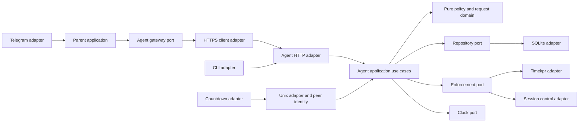

# Repository review and implementation plan

Reviewed on 2026-10-18 against commit `f26d3c9ad6031330ea00d732464bf02825c08c4f`
and the working tree. Existing changes to `flake.nix`, `flake.lock`, and
`recovery/sources.json` were present before the review and were preserved.

The repository is small enough to improve incrementally. Its main problem is
correctness at the boundaries between policy, persistent state, Timekpr, and user
interfaces. A modest hexagonal architecture is appropriate. Moving the current
methods into more files without fixing their contracts would preserve the bugs.

This document records the original review baseline, before implementation.
See [the implementation report](implementation.md) for current fixes and checks.
Source line references below refer to the reviewed commit, not the current tree. No live
configuration, runtime database, account, identifier, or Telegram conversation
was changed. No deployment or activation was performed.

## Scope and evidence

Read all five application Python modules, the existing tests, all five Nix
modules, packaging, flake checks, CI, README, and both source-access helpers.
Inspected the packaged Timekpr 0.5.8 source to verify integration assumptions.
Researched official Google, Apple, Microsoft, Telegram, Python, and Tk material.

| Check | Result | What it establishes |
| --- | --- | --- |
| Existing suite under pytest 9.1.1 / Python 3.12.13 | 4 passed | Existing relay outage cases pass |
| Application statement coverage | 21% overall | Daemon, CLI, and countdown have 0% coverage |
| Explicit review cases | 19 failed, 1 passed | Desired behavior assertions reproduce specific defects; unauthorized mutation is rejected |
| Countdown creation in isolated Xvfb, packaged Python 3.13.13 / Tk 8.6.16 | Failed: `bad option "class"` | The real GUI construction fails without using the live desktop |
| Recovery-wrapped `nix flake check` | Passed on x86_64-linux | Package builds, current unit check, and module expression evaluation pass |
| aarch64-linux build/runtime | Not exercised | No cross-platform validation claim |
| Default Ruff check | Passed | Only default rules; no repository lint policy exists |
| Ruff formatting check | 6 existing files would change | Formatting is inconsistent |
| Expanded Ruff I/UP/B/S/SIM/C4 scan | 16 diagnostics | Reviewed as leads, not 16 confirmed security vulnerabilities |
| Activated NixOS / actual session enforcement | Not exercised | Requires a later, separate validation stage |

The original explicit regression run reproduced 19 failures and one passing
security check. Its temporary review harness has been retired as the implementation
changed; maintained pytest cases now live in `pkgs/family-controls/tests`.
The table above is historical baseline evidence, not the current test result.

## Findings

P1 means fix before expanding the product or treating it as reliable enforcement.
P2 means significant correctness, usability, or maintainability work. P3 means
cleanup. “Reproduced” refers to isolated checks, not a claim about live deployment.

### R01 — P1: Child-agent TLS does not authenticate the server

Sources: [common.py:187–210](../../pkgs/family-controls/src/common.py),
[relay:84–104](../../pkgs/family-controls/src/family_controls_relay.py),
[CLI:61–133](../../pkgs/family-controls/src/family_controlsctl.py).

The shared HTTP client defaults to `verify=False`; relay and CLI explicitly
disable verification. An attacker able to intercept the connection can impersonate
the child agent, obtain its bearer credential, and forge status or control calls.
This is a conditional network attack, not evidence of an existing compromise.
Reproduced: the default HTTPS call constructs `CERT_NONE`.

Default to verified TLS. Support a configured CA or explicit certificate/public
key pin suitable for the private network; reject redirects for authenticated
control requests. The bootstrap certificate has only a CN and no SAN, so simply
flipping a boolean is not a complete migration. Add reusable trust options here;
configure actual identities and trust material in nix-config. Preserve existing
keys until an explicit rotation/migration is planned.

### R02 — P1: The countdown cannot construct its window

Source: [sessiond:23–25](../../pkgs/family-controls/src/family_controls_sessiond.py).

`wm class` is not a supported Tk subcommand. Calling `ensure_window()` under the
packaged Tk in isolated Xvfb raises `TclError: bad option "class"`. The exception
is outside `tick()`'s transport error handler, so it also interrupts scheduling.
Set the class at Toplevel creation and verify the actual window identity against
the Plasma rule. The [Tk wm reference](https://www.tcl-lang.org/man/tcl8.6.14/TkCmd/wm.htm)
and [Toplevel options](https://www.tcl-lang.org/man/tcl9.0/TkCmd/toplevel.html)
describe the supported interfaces.

### R03 — P1: Concurrent commands lose changes

Source: [daemon:70–99, 134–153, 391–419](../../pkgs/family-controls/src/family_controlsd.py).

The mutex protects individual SQLite calls, not a whole read-modify-write
operation. Two requests can read the same bonus, then overwrite one another.
Reproduced with a deterministic barrier: simultaneous +5 and +15 leave either
5 or 15, not 20. Housekeeping can also interleave external policy commands with
parent actions and apply an older policy after a newer one.

Use a transaction for state transitions and an ordered, revision-aware enforcement
path. Serializing only database statements or enabling WAL does not fix this.

### R04 — P1: Invalid commands poison persistent policy

Source: [daemon:432–455](../../pkgs/family-controls/src/family_controlsd.py).

`until` is stored before it is parsed. Reproduced: `until="invalid"` raises an
error but remains in `effective_overlay`. Subsequent status and reconciliation
calls fail when parsing it. Housekeeping then silently suppresses the failure.
Other commands likewise persist state before external enforcement and audit
completion, so a failed response does not mean nothing happened.

Validate the full command before writing. Persist desired policy, audit intent,
and an operation ID atomically; track application success separately. Reject
invalid input without changing state. An external process and SQLite cannot be
made atomic by wrapping only the SQL in a transaction.

### R05 — P1: Timekpr CLI exit status is insufficient proof of success

Sources: [daemon:101–108](../../pkgs/family-controls/src/family_controlsd.py),
[common:177–180](../../pkgs/family-controls/src/common.py).

The adapter trusts `subprocess.run(check=True)`. Inspection of the packaged
Timekpr 0.5.8 shows `processSetPlayTimeLimits()` prints nonzero D-Bus result
messages without propagating that result as a process exit code. The entry point
does not translate these results either. `--userinfo` failure output can also be
parsed as an empty or incomplete status; `safe_int` converts missing data to zero.

Consequently a failed enforcement call can look successful, and unavailable
telemetry can look like exhausted time. Use the structured D-Bus return contract,
or a carefully validated CLI adapter with readback. Model unknown telemetry as
unknown, not zero. This is source-verified integration behavior; no commands were
sent to the live Timekpr service.

A concrete affected path is blocking: the agent sends `--setallowedhours user day
""`. In the packaged CLI, splitting this empty argument produces an empty token;
`findHourStartEndMinutes()` returns no hour, so the CLI prints a parsing error and
does not call `setAllowedHours`. Empty allowed schedules use the same path. With
`killSessions=False`, there is no agent termination fallback. With it enabled,
session termination can mask the failed Timekpr policy change. Validate an actual
supported deny-all operation rather than relying on a successful process exit.

### R06 — P1: One stalled operation can stop enforcement progress

Sources: [common:177–180, 213–238](../../pkgs/family-controls/src/common.py),
[daemon:507–517, 557–645](../../pkgs/family-controls/src/family_controlsd.py).

Timekpr/loginctl subprocesses have no deadline. The single housekeeping loop
processes all users sequentially and suppresses every exception. A hang blocks
the rest of that loop indefinitely; a persistent error leaves a running process
with no useful health signal. Unix requests also have no timeout.

Add bounded calls, explicit error classes, per-user failure isolation, structured
logs, and health showing last successful reconciliation. Choose and document the
behavior when telemetry is unavailable. Do not blindly terminate sessions because
an unreadable counter was converted to zero.

### R07 — P1: Local socket ownership does not establish child identity

Sources: [daemon:62, 533–554](../../pkgs/family-controls/src/family_controlsd.py),
[parental-controls.nix:406, 433](../../modules/nixos/parental-controls.nix).

Every managed user joins the same group, while both Unix endpoints operate on
`primary_user`, the first configured user. On a multi-user host the second child
sees and requests time for the first. There is no peer-credential check. The
socket's parent directory is group-writable (`0770`), allowing a managed group
member to unlink or replace the socket path. Socket mode `0660` does not prevent
that directory operation. This enables denial/spoofing of the local UI, not by
itself remote administrative privilege.

Use a root-owned, non-group-writable runtime directory and authenticate Unix peers
with Linux peer credentials. Resolve UID to an existing managed user; explicitly
reject unknown users. Include a two-user integration test.

### R08 — P1: Countdown ignores the next cutoff and can disagree with expiry

Source: [daemon:284–357](../../pkgs/family-controls/src/family_controlsd.py).

The code prefers saved `TIME_LEFT_DAY` and `PLAYTIME_LEFT_DAY` over live fields.
Timekpr's saved daily total includes later windows, whereas the child needs time
until the current window ends. `classify_time()` calculates that boundary, but
`_status()` ignores it. Reproduced: at 09:59 with windows 09:00–10:00 and
11:00–12:00, the countdown reports an hour instead of one minute. A separate case
confirms stale PlayTime takes precedence over live PlayTime.

Filtering out zero counters before taking the minimum is also wrong: an expired
PlayTime budget can coexist with a positive countdown. Reproduced: expired status
reports 7,200 seconds. Derive one effective decision from live telemetry, current
window, and policy, and reuse it for status, warning, and enforcement.

### R09 — P1: “Unmetered” windows mean different things to two components

Sources: [common:141–164, 259–274](../../pkgs/family-controls/src/common.py),
[parental-controls.nix:143–150, 211–215](../../modules/nixos/parental-controls.nix).

The encoder unconditionally opens unmetered minutes even outside allowed windows.
The status classifier says access is forbidden outside allowed windows. Reproduced
with disjoint allowed and homework windows. Reducing an access window can therefore
leave Timekpr allowing an unmetered interval that the agent treats as expired.

There is a second semantic distinction: Timekpr's unaccounted general-use periods
and PlayTime activity accounting are separate settings. The generated config sets
`PLAYTIME_UNACCOUNTED_INTERVALS_ENABLED=False`. Do not promise free game time from
an unmetered schedule without a contract test. Decide whether homework is allowed
access with games restricted, or exemption from a particular budget. Normalize
the intervals once and make the encoder and evaluator agree.

### R10 — P1: Configured timezone is ignored; the obvious fix exposes another bug

Sources: [common:61–66](../../pkgs/family-controls/src/common.py),
[daemon:155–177](../../pkgs/family-controls/src/family_controlsd.py).

`hasattr(datetime, "zoneinfo")` is false in the tested interpreters; `zoneinfo` is
a separate module. `local_now()` silently returns a naive host-local timestamp.
This fails when configured and process timezone differ and produces ambiguous
audit timestamps around DST. It may appear correct on a matching host timezone.

Reproduced independently: passing a correctly timezone-aware clock to access
extension crashes because `datetime.combine()` creates naive comparison values.
Fix both together. Use an injected aware clock, a defined policy timezone, and
local calendar-day expiry. [Python's ZoneInfo documentation](https://docs.python.org/3/library/zoneinfo.html)
describes timezone-aware datetime integration.

### R11 — P1: Today-only changes are written into recurring Timekpr settings

Source: [daemon:252–264](../../pkgs/family-controls/src/family_controlsd.py).

An adjusted daily cap is written to all seven weekdays. An altered access window
is persisted for today's weekday. Removing the SQLite overlay tomorrow only
works as a complete reset if reconciliation is running successfully; old weekday
windows are not all restored at rollover. If the agent stops while Timekpr keeps
running, a temporary grant or block can remain in its persisted configuration.

Define a single owner for policy, explicitly restore the full baseline plus valid
overrides, and test restart/rollover/failure recovery. Do not implement “unlimited
today” as a permanent toggle that requires an unreliable cleanup job. The
offline-expiry guarantee needs a deliberate enforcement design and VM evidence.

### R12 — P1: Approval callbacks are replayable and are not bound to requests

Source: [relay:327–374, 453–517](../../pkgs/family-controls/src/family_controls_relay.py).

Callbacks contain child/action/minutes, not a request ID or revision. There is no
durable deduplication. Reproduced: delivering the same callback ID twice grants
twice. Old request messages remain actionable after local tracking is dropped;
they can approve a different day's state. Two parents can both act on one request.

Store request IDs and decision state; atomically transition pending to decided.
Deduplicate transport delivery separately from distinct deliberate adjustments.
Disabling a Telegram keyboard is useful feedback, but is not the integrity guard.

### R13 — P1: Telegram update processing can lose or replay commands

Source: [relay:33–34, 695–705](../../pkgs/family-controls/src/family_controls_relay.py).

The offset advances before processing and exists only in memory. Reproduced:
handler failure still advances offset 42 to 43. The next poll can acknowledge
the failed update. Conversely, a crash after applying a command but before the
next poll can redeliver it after restart. Pending message tracking is also lost.

Persist receipt/outcome and use stable operation IDs through to the agent. Advance
the acknowledgement frontier after durable handling, including explicit terminal
rejections. A “save offset” patch alone cannot close the remote-side-effect crash
window. This follows the acknowledgement semantics in the
[Telegram getUpdates documentation](https://core.telegram.org/bots/api#getupdates).

### R14 — P2: Request lifecycle strands children and loses notifications

Sources: [daemon:300–331, 381–389](../../pkgs/family-controls/src/family_controlsd.py),
[relay:339–374](../../pkgs/family-controls/src/family_controls_relay.py).

Pending requests never expire by date, and there is no deny, cancel, or resolved
state. Reproduced: yesterday's pending request prevents a fresh one today. The
relay sends only when `phase == "pending_request"`; expiry has higher precedence.
A request made just before exhaustion can therefore never be announced. That
failure is reproduced. The child also cannot create a request once expired.

Separate request status from access status. Deliver durable requests regardless
of the current access phase, subject to explicit expiry. Add deny, cancellation,
cooldown, and child-visible outcomes. Decide whether mute expires today or remains
until revoked; currently it is indefinite and the interface does not explain it.

### R15 — P2: HTTP routes and payloads have inconsistent validation

Sources: [common:27–34](../../pkgs/family-controls/src/common.py),
[daemon:562–621](../../pkgs/family-controls/src/family_controlsd.py).

Reproduced: malformed JSON, unknown users, and missing path components escape as
exceptions; extra path segments can still execute mutations. Body decoding occurs
outside the error handler. There is no object-schema validation, maximum body
size, or upper minute limit. `today` accepts arbitrary truthy values. Internal
errors are broadly mapped to 400 with raw exception messages.

Use exact routing and validated request models. Return stable 400/401/403/404/409,
413, and 503 classes as appropriate. Validate identifiers before state writes or
external calls. Cap input size and duration; distinguish malformed data, conflicts,
and temporarily unavailable dependencies. Avoid leaking internal command details.

### R16 — P1: Network service resource limits and exposure are too permissive

Sources: [daemon:557–645](../../pkgs/family-controls/src/family_controlsd.py),
[parental-controls.nix:425, 450–466](../../modules/nixos/parental-controls.nix).

The daemon binds all IPv4 interfaces and the module opens the port globally.
`ThreadingHTTPServer` has no application connection cap/read deadline here.
TLS is wrapped around the listening socket with default handshake behavior;
stalled handshakes require particular attention because acceptance can block
before normal request dispatch. Authorized clients can also claim oversized or
incomplete bodies. These are source-derived resource exhaustion risks, not a
load-tested exploit against the deployment.

Expose reusable bind/interface options, bounded concurrency and read/handshake
timeouts. Keep private-network/firewall choices in nix-config. Authenticate
nonempty credentials and use constant-time token comparison as routine hardening.

### R17 — P2: Invalid configuration is accepted until the service is running

Sources: [Nix option definitions](../../modules/nixos/parental-controls.nix),
[relay options](../../modules/nixos/telegram-relay.nix),
[daemon constructor](../../pkgs/family-controls/src/family_controlsd.py).

Negative/zero poll intervals and negative limits are allowed by `types.int`.
The JSON entry point does not validate configuration. Window ordering, overlap,
weekday keys, and timezone are not checked consistently. `with_overlay()` assumes
the last configured interval is latest. Boot rendering accepts `24:00`, while
the runtime `datetime.time` parser rejects it. Relay children can lack API tokens;
case-insensitive child-name collisions and callback delimiter/length problems
are not rejected.

Validate once at startup and add Nix assertions for values knowable at evaluation.
Sort/normalize intervals or reject invalid order explicitly. Define a half-open
day endpoint at 24:00 and an explicit overnight-window policy. Preserve existing
external IDs while adding stable internal references.

### R18 — P2: Independent enforcement paths and locked-time accounting conflict

Sources: [daemon:266–282, 507–517](../../pkgs/family-controls/src/family_controlsd.py),
[module:64–78, 99–106, 479–489](../../modules/nixos/parental-controls.nix).

With `killSessions=True`, the agent invokes `terminate-user` for expired status
regardless of a configured lock/suspend/shutdown action. It can terminate before
Timekpr's configured countdown finishes. Locked-time accounting deducts the
configured poll interval, not measured elapsed time, and runs independently of
budget/window/block state. Any active locked session triggers it even if another
session is in use. Interaction with Timekpr inactive accounting needs validation
to prevent double charging.

Choose one enforcement policy and grace deadline. Use monotonic elapsed time for
usage accounting, avoid counting the same interval twice, and specify multi-session
behavior. Test suspend/resume and reboot separately from simple clock advancement.

### R19 — P2: Status polling writes state and repeatedly reapplies unchanged policy

Sources: [daemon:252–264, 337–344, 507–517](../../pkgs/family-controls/src/family_controlsd.py),
[sessiond:49–77](../../pkgs/family-controls/src/family_controls_sessiond.py).

Every status read writes `desired_dns_profile` and updates/deletes countdown state.
Reproduced: two identical reads increase SQLite changes. The default loop also
launches at least three Timekpr commands per user per iteration, reapplies all
seven limits, then sleeps one second. The desktop adds another status command
roughly every second. CLI startup, IPC, config saves, and SQLite commits dominate
the tiny interval computations.

Keep queries free of writes. Cache timestamped observed status; apply policy only
when its revision changes or drift is detected. Reconcile periodically with an
explicit bounded frequency. Keep the straightforward 1,440-minute representation
unless profiling establishes that it matters.

### R20 — P2: An unhealthy child delays other children and parent interaction

Source: [relay:246–250, 339–374, 707–718](../../pkgs/family-controls/src/family_controls_relay.py).

Child polling is sequential and precedes the up-to-20-second Telegram long poll.
N unreachable children can add roughly N×5 seconds before parent commands are
handled. HTTP errors and invalid successful response schemas escape child-level
handling and abort the whole pending-request scan, starving later children.

Separate polling schedules and isolate errors per child. Use bounded concurrency,
backoff, and last-success timestamps. Handle Telegram response errors and rate-limit
retry hints centrally. For a household, a small worker pool is sufficient; a broker
or a broad async rewrite is not necessary just for this issue.

### R21 — P2: Desktop lifecycle and communication can freeze the interface

Source: [sessiond:18–77](../../pkgs/family-controls/src/family_controls_sessiond.py).

Blocking Unix HTTP runs on the Tk event thread without a timeout. Closing a window
through the window manager leaves `self.window` referring to a destroyed widget,
so `ensure_window()` will not recreate it. The request button remains available
for muted/pending phases, request failures are not displayed, and connection
failure silently removes the window.

Use bounded worker communication and marshal results onto Tk. Reset the window
reference on close, schedule the next tick in a reliable lifecycle path, disable
inapplicable actions, and display stale/unavailable state. After R02, add real GUI
smoke coverage for open, close/reopen, pending, muted, expiry, and connection loss.

### R22 — P2: Deducting time silently ignores the final partial minute

Source: [daemon:407–430](../../pkgs/family-controls/src/family_controlsd.py).

`remaining_seconds // 60` rounds down before deduction. Reproduced: removing one
minute with 59 seconds remaining applies zero minutes. The relay nevertheless
reports the requested amount as deducted. Keep domain arithmetic in seconds;
return both requested and applied deltas and render the actual result.

### R23 — P2: DNS profile is desired state only

Source: [daemon:309–316, 344–353](../../pkgs/family-controls/src/family_controlsd.py).

The repository computes and stores a DNS profile but contains no adapter that
applies it or reads back the result. An external deployment consumer may exist;
this review did not inspect private runtime knowledge. The software must not
present this field as evidence that filtering is active. Document the output
contract, expose desired/applied/unknown separately, and only add a DNS adapter
when a real provider contract is selected.

### R24 — P2: Tests and CI do not establish the advertised guarantees

Sources: [existing tests](../../pkgs/family-controls/tests/test_family_controls_relay.py),
[flake checks](../../flake.nix), [CI](../../.forgejo/workflows).

Four `unittest` tests use `unittest.mock`; there is no pytest configuration,
coverage gate, type-check configuration, or reproducible developer environment.
The existing tests cover relay outages, not authorization denial, transitions,
state races, restart, day rollover, TLS, HTTP parsing, or GUI creation. The module
check writes an evaluated ExecStart string; it neither boots a VM nor demonstrates
full-system assertion validity. Home Manager and Plasma imports lack meaningful
integration checks. Shared recovery scripts are not tested by this repository's
four-test suite even though README references testing in their source repository.

Adopt the copied pytest guidance, migrate the four tests, and add focused behavior
and contract tests. Gate at least 70% application coverage with explicit branch
coverage visibility. Critical policy/security paths need scenario coverage even
if the global percentage passes. Keep build, VM tests, activation, and runtime
validation separately reported.

### R25 — P2: Business rules are duplicated or mixed with infrastructure

Sources: [common.py](../../pkgs/family-controls/src/common.py),
[daemon](../../pkgs/family-controls/src/family_controlsd.py),
[embedded boot Python](../../modules/nixos/parental-controls.nix),
[relay](../../pkgs/family-controls/src/family_controls_relay.py),
[CLI](../../pkgs/family-controls/src/family_controlsctl.py).

`Agent` owns SQL, audit, policy, clock, Timekpr, loginctl, request lifecycle, and
housekeeping. The 734-line relay owns Telegram transport, authorization, routing,
presentation, and child-agent transport. Boot-time interval encoding duplicates
`common.py` and already differs in parsing. Command/action mappings and HTTP calls
are repeated across multiple branches. `common.py` mixes domain time logic with
HTTP, TLS, subprocesses, and filesystem helpers.

Extract cohesive modules and narrow ports as described below. Share one policy
normalizer/encoder with the boot generator. A small typed command mapping is
reasonable; a generic dynamic command framework is unnecessary.

### R26 — P3: Readability, documentation, and packaging need a defined standard

Sources: application modules, [packaging](../../pkgs/family-controls/default.nix),
[README](../../README.md).

Untyped nested `dict[str, Any]` values obscure contracts. Private helpers are called
across HTTP boundaries. Dynamic `__import__("ssl")` adds no value. The parser's
`sys.path` manipulation in tests and generic `common` module reflect script-style
packaging. Public interfaces lack useful docstrings and there is no API/policy
reference or documented failure behavior. Ruff formatting differs in six files.

Use a real `family_controls` package and normal imports; Pydantic at configuration
and transport boundaries, small typed dataclasses/enums in the core. Standardize
formatting and a restrained lint/type policy. Document units, expiry, precedence,
failure outcomes, and operational contracts; avoid comments that narrate obvious
code. The `sqlite` command-line package appears unused by the Python daemon;
`deviceId`, `countdown_started_at`, and the one-value kiosk profile have no useful
consumer here. Preserve IDs and compatibility, then remove unused plumbing through
explicit deprecation rather than silently dropping it.

### R27 — P2: Service privileges and audit attribution are incomplete

Sources: [relay service](../../modules/nixos/telegram-relay.nix),
[daemon service](../../modules/nixos/parental-controls.nix),
[audit schema](../../pkgs/family-controls/src/family_controlsd.py).

The network-facing relay runs as root by default despite not needing enforcement
privileges. Neither service defines a meaningful sandbox. The audit log records
child/action/details but not parent identity, command/request ID, previous state,
or enforcement outcome; it grows without a retention policy.

Give the relay a dedicated service identity with explicit credential access and
only its own state directory. Harden the privileged agent around the actual
Timekpr/loginctl requirements and verify the sandbox in a VM. Propagate an
authenticated actor through adapters; record intent and outcome without tokens.
Use a retention/export policy selected by the deployment. Do not assume adding
`DynamicUser` alone will preserve access to the existing SOPS files.

### R28 — P1: The schedule encoder can produce intervals Timekpr cannot represent

Sources: [common:285–311](../../pkgs/family-controls/src/common.py),
[boot encoder](../../modules/nixos/parental-controls.nix).

The encoder permits multiple tokens for one hour, for example `9[00-30];!9[30-60]`
when homework begins at 09:30 within an otherwise allowed hour. The packaged
Timekpr CLI's `processSetAllowedHours()` stores these in a dictionary keyed only
by hour; the later token overwrites the earlier one. Disjoint intervals within
the same hour have the same problem. Thus a valid-looking minute-level schedule
can silently lose allowed minutes or change their accounting mode.

Treat adapter representability as part of validation. Reject unsupported policies
with a clear explanation, or design a proven enforcement mechanism that preserves
their semantics. Do not silently round/merge across forbidden gaps. Add repository
adapter contract tests for mixed metering and multiple intervals within one hour.

## What is already sound

SQL values are parameterized, subprocesses use argument lists rather than shell
interpolation, and Telegram control checks both the configured chat and the
sender's administrator role. The socket exposes only status/request operations,
not parent mutations. Minutes reject booleans at the HTTP boundary. The relay has
explicit child-network timeouts and tested outage messaging. Source recovery
preserves locked revisions/hashes and distinguishes transport failures from
authentication/integrity failures. CI actions are pinned. These should be retained.

The broad Ruff subprocess and URL diagnostics are not proof of command injection
or arbitrary-file access in these call sites: executable paths/hosts come from
trusted configuration and commands use lists. The concrete TLS issue is R01.

## Proposed architecture

Keep the existing process topology and offline local enforcement. Telegram is a
driving adapter for parent workflows; HTTP/Unix/CLI are other driving adapters.
Timekpr, SQLite, loginctl, and the remote agent client are driven adapters. The
domain must not import Telegram, HTTP, SQLite, Tk, Nix, or subprocess modules.



The parent process translates an authenticated chat action into the same command
contract used by other adapters. The child agent remains authoritative for that
device's usage and applied policy. Adding another parent channel should require
its authorization/presentation adapter, not a second implementation of time rules.

Suggested initial layout, split further only when a module becomes incoherent:

```text
src/family_controls/
  domain/
    models.py          # IDs, seconds, windows, policy, overrides, decisions
    policy.py          # Pure effective-policy calculation
    requests.py        # Request lifecycle and decision rules
  application/
    commands.py        # Use cases and transaction boundaries
    queries.py         # Read-only status and history
    reconcile.py       # Desired/applied revisions and bounded retries
    ports.py           # Small Protocols used by these workflows
  adapters/
    telegram.py        # Authorization, conversation, formatting, inbox
    http_api.py        # Exact routes, schemas, authenticated principal
    agent_client.py    # Verified transport and operation IDs
    unix_api.py        # Peer credentials and child-scoped requests
    sqlite.py          # Migrations, transactions, operations, audit
    timekpr.py         # Structured enforcement/telemetry contract
    sessions.py        # loginctl boundary
    countdown.py       # Tk view/controller
    cli.py
  config.py            # Validated configuration
  bootstrap.py         # Explicit dependency construction
tests/
  unit/
  contract/
  integration/
```

Prefer a few narrow Protocols and explicit constructors. Do not add a DI framework,
plugin discovery, event sourcing, a message broker, generic repositories, or an
HTTP framework solely to claim hexagonal architecture. A mature bounded HTTP
implementation can be selected for concrete security/validation needs. SQLite
is adequate for this scale.

### Domain contracts

| Concept | Required semantics |
| --- | --- |
| Usage | Seconds, authoritative observation time, known/stale/unknown state |
| Recurring policy | Weekday schedule, activity budget, homework semantics |
| Daily override | Child/device, local date, kind/value, creator, ID, revocation |
| Access decision | Allowed/blocked/exhausted/outside schedule, reason, next transition |
| Request | Stable ID, requested amount/reason, created/expiry times, pending/approved/denied/cancelled/expired |
| Operation | Stable ID, actor, expected revision, desired change, application outcome |
| Enforcement | Desired revision, applied revision, last success/error; stale results cannot overwrite newer state |

Use explicit `unlimited` state rather than a huge number or overloading zero.
Access state, connectivity, and request state are independent fields; one `phase`
enum cannot faithfully represent them all. “Offline” must never mean “zero time.”

For command execution: validate and authorize; compute the transition; atomically
record desired state, operation and audit intent; apply through the enforcement
adapter in order; store the result; return applied/pending/failed truthfully.
Reconciliation after restart resumes durable intent without repeating additive
effects. Existing state keys and usage balances remain readable through a tested,
versioned migration. Do not recreate either existing state directory.

## Product plan and external inspiration

Google Family Link offers today-only bonus time that can be increased or reduced
without editing the recurring schedule, plus weekly limits and scheduled downtime.
Its documented daily limit is per device, not one shared household pool. These are
useful patterns for explicit scope and reversible daily changes.
[Google screen-time documentation](https://support.google.com/families/answer/7103340?hl=en),
[Google schedule documentation](https://support.google.com/families/answer/15938652?hl=en-EN).

Apple provides request decisions for 15 minutes, an hour, or the rest of the day,
with approval/denial from notifications and Messages. Borrow the small set of clear
decisions and the request lifecycle, while adding custom durations.
[Apple Screen Time requests](https://support.apple.com/guide/iphone/respond-to-a-screen-time-request-iph74e434e84/ios).

Microsoft separates when a device may be used from how much time is available,
and supports day-specific schedules and turning limits off. Borrow that distinction
and make it visible in the parent interface.
[Microsoft screen-time limits](https://support.microsoft.com/en-gb/family-safety/set-screen-time-limits-across-devices).

These are design inputs, not claims that their platform-specific capabilities
already exist on Linux or can be reproduced by Timekpr unchanged.

### First feature release

| Feature | Proposed behavior | Acceptance example |
| --- | --- | --- |
| Custom bonus time | Presets plus “Custom…” accepting `25m` / `1h 10m`; changes today's quota only | +25m adds 1,500 seconds once and states whether schedule still blocks use |
| Set today's total | Absolute cap, distinct from adding remaining time | Set 90m with 40m used leaves 50m; repeated submission is idempotent |
| Set time remaining | Optional explicit operation based on current usage and revision | “Leave 20m” does not silently mean “add 20m” |
| Allow access until | Specific local cutoff with clear date/timezone | Until 19:30 previews schedule change; it does not silently replenish PlayTime |
| Grant a session now | Combined, explicit schedule exception and required budget | “Allow 25m now” works when both constraints are exhausted, subject to manual-block policy |
| Unlimited budget today | Remove today's quota only; preserve schedule and manual block | Expires at next local midnight and still ends access at bedtime |
| Allow for rest of day | Separate stronger exception for quota and schedule | Clearly previews both overrides; manual block requires explicit resolution |
| Restore today's defaults | Revoke daily overrides without erasing consumed time | Usage remains 40m; recurring policy is unchanged |
| Resolve requests | Approve custom/preset/all-day, deny with optional reason, cancel | Two parents deciding the same request produce one decision |
| Explain current state | Budget, cutoff, reason blocked, last seen, applied/pending result | “20m left, access ends 18:00; device last seen 30s ago” |

Recommended precedence: an explicit manual block wins; a separately authorized
unblock removes it. Daily budget exceptions override the recurring budget but
not the schedule. Schedule exceptions override scheduled access for their stated
scope. Homework rules remain explicit. Unknown/stale enforcement is reported
alongside the intended decision. These are proposed product semantics to settle
before implementation, not undocumented changes to current behavior.

Today expires at the next midnight in the policy timezone, including 23-/25-hour
DST days. Continue measuring usage while unlimited so restoring limits is honest.
An absolute cutoff that has already passed should produce a clear error or an
explicit next-day choice, never an implicit overnight grant. A blanket ban on
23:59–24:00 should not result from the parser representation.

### Telegram interaction

Start with `/family` or `/status` showing one concise card per child/device:

```text
Child · laptop · online
Play time: 20m left of 60m today
Access: until 18:00 · changes applied

[Add time] [Set today's limit] [Allow until…]
[Unlimited today] [Pause access] [Requests]
[Restore defaults] [History]
```

The add-time screen offers presets and Custom. A custom input belongs to the
initiating parent, chat, child/device, operation, and expiring conversation; another
parent's next message must not be consumed by it. Include Cancel/Back and a final
plain-language result. Resolve request buttons by opaque short IDs, with server
validation of request state and expiry. Show which parent decided and notify the
child. Broad all-day overrides should preview their scope; ordinary small grants
should stay fast.

Text commands should remain useful for experienced users. Existing `/addtime child
25` and `/extendaccess child 25` already support custom integers; improve their
discoverability rather than describing them as new backend capabilities. Explain
that the latter currently shifts the final scheduled endpoint, which can fail to
give usable time when that endpoint is already in the past.

### Later, after reliability

Prioritize weekday/weekend budgets, named school/holiday schedules, temporary
pause with automatic resume, child-requested duration/reason, and simple daily/
weekly usage summaries with configurable retention. Then add a second adapter
against the same use cases as a real architecture check.

Defer shared cross-device budgets until an actual need exists: partition handling
and double spending require a separate design. Preserve `deviceId` now so that
future work does not require identity churn. Also defer per-app catalogs, web
dashboards, offline parent codes, rewards systems, browsing histories, and location
tracking. They expand enforcement, authentication, or privacy scope substantially.

## Implementation sequence

Each phase should be a small set of reviewable Forgejo changes, with tests and
documentation alongside behavior. Do not turn the whole refactor into one PR.

| Phase | Deliverables | Exit evidence |
| --- | --- | --- |
| 1. Test foundation | Real package/test configuration; migrate existing tests to pytest/monkeypatch; pinned developer tools; meaningful Nix module fixtures | Existing behavior tests pass; CI runs pytest; coverage baseline visible; no blanket warning suppression |
| 2. Immediate correctness/security | R01–R10, R12–R16, R28 prioritized by risk; GUI construction; validation before persistence; atomic updates; authenticated peers; deadlines | Relevant review cases promoted and passing; invalid input leaves state unchanged; duplicate/concurrent operations safe; TLS rejection tests |
| 3. Extract the core | Typed policy/request models, injected clock, application commands/queries, small ports; shared boot/runtime encoder | Domain tests have no I/O; adapters exercise shared contracts; unchanged state/ID migration fixtures pass |
| 4. Durable enforcement and recovery | Desired/applied revisions, operation records, request lifecycle, ordered reconciliation; reliable day reset; service hardening | Restart and partial-failure tests; no duplicate grants or stale override persistence; status reports failures truthfully |
| 5. Parent/child usability | Custom input flows, set-today, unlimited-today, explicit session grants, restore, deny/cancel, clear result/status | Feature acceptance examples above pass through Telegram and CLI; GUI stays responsive and explains status |
| 6. Release validation | Full pytest/coverage/type/lint gates; NixOS VM and Home Manager fixtures; operator/policy/API docs | At least 70% application coverage, critical scenarios covered, build and VM checks pass; activation/runtime evidence separately collected in deployment work |

Some extraction in phase 2 is sensible when needed for a safe fix. Keep it scoped
to the behavior under test; do not delay the GUI/TLS/invalid-state fixes for a
complete architectural rewrite. TLS enforcement needs a compatible deployment
trust rollout before activation. Preserve state paths, user/device identifiers,
existing secrets, and usage accounting throughout.

### Test matrix

| Layer | Essential cases |
| --- | --- |
| Pure policy | Start/end boundaries, gaps, overlap, ordering, full-day endpoint, weekday fallback, exhausted vs unlimited, homework semantics, precedence |
| Clock/expiry | Different process/policy zones, both DST transitions, midnight, year change, restart next day, wall-clock changes versus monotonic elapsed usage |
| Commands/storage | Concurrent grants, duplicate operation, rollback on invalid input, request decision race, partial enforcement failure, crash recovery, existing SQLite migration |
| Timekpr adapter | Saved/live telemetry distinctions, missing fields, semantic failure despite process success, timeout, actual applied-state readback, temporary override expiry |
| HTTP/Unix | Unauthorized/unknown identity, peer UID isolation, malformed/oversized bodies, strict path matching, bounded connections, certificate/hostname mismatch, unavailable dependencies |
| Telegram | Non-parent/non-admin, duplicate/stale callbacks, restarts, custom-input ownership, expired conversation, message delivery failure, rate limits, multiple children with one failing |
| Desktop | Actual Tk window creation, close/reopen, pending/denied/muted/expired, no UI-thread blocking, connection loss/recovery, correct Plasma matching |
| Nix | Valid and invalid configurations, disabled/enabled services, two users, relay credentials/trust, Home Manager imports, VM restart/rollover/enforcement |

Use pytest fixtures, `tmp_path`, parametrization, monkeypatch, and small behavior
fakes. Test this repository's decisions and adapter contracts, not dependency
internals. Use real temporary SQLite and local test servers where they establish
transaction/protocol properties that mocks cannot. Test supported Timekpr behavior
through integration contracts without modifying its source. Avoid sleep-based
unit tests; inject clocks and use deterministic synchronization for races.

## Documentation and acceptance standard

Add a concise development guide with one test command, a policy semantics guide,
an API/error contract, and a short architecture decision record. Document state
schema evolution, trust configuration, reconciliation failures, restore/rollback,
and the separate responsibilities of this repository and nix-config. Keep copied
source-recovery helpers synchronized with their upstream implementation and bring
their relevant shared tests into the validation story rather than casually forking
their behavior.

“Perfectly working” is not a verifiable release claim. A useful acceptance standard
is: every supported action has defined semantics; failures cannot silently grant,
lose, or misreport time; decisions survive retries/restarts; daily exceptions expire
correctly; parent and child see the same effective state; and the critical behavior
is demonstrated by repeatable tests plus separately reported deployment validation.
